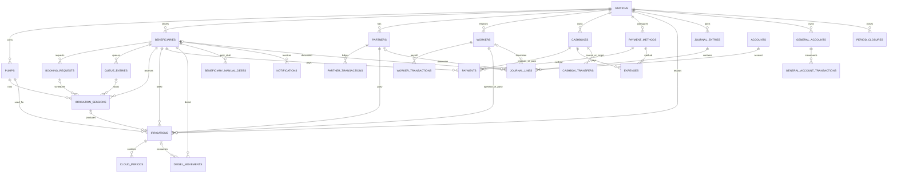

# معمارية قاعدة البيانات وربط Firebase — منظومة ساقية

> **الحالة:** وثيقة تصميم ومراجعة، وليست تنفيذًا لربط Firebase.
> **الفرع المرجعي للفحص:** `main` عند الالتزام `d81f76d58a0317a74214d0185b014a3941ef16bf`.
> **القرار المعتمد:** لكل محطة Firebase Project مستقل تمامًا، وقاعدة SQLite محلية مستقلة.
> **حدود هذه الوثيقة:** توثق ما أمكن التحقق منه في ملفات المخطط والترقيات والخادم، وتفصل بوضوح بين الواقع الحالي والتصميم المقترح. لا تنشئ مشاريع Firebase ولا تغيّر قاعدة بيانات المستخدم.

## 1. ملخص القرار المعماري

تعتمد المنظومة بنية **Offline-first + محطة معزولة**:

1. SQLite تبقى قاعدة التشغيل المحلية الأساسية على جهاز المحطة، وتستمر الشاشات والخدمات الحالية بالعمل دون اتصال.
2. لكل محطة مشروع Firebase مستقل (Authentication وFirestore وStorage وFunctions/الخدمات الخلفية وFCM عند الحاجة). لا تُجمع بيانات محطتين في مشروع بيانات واحد.
3. يحتفظ النظام المركزي — إن تم إنشاؤه — بسجل تعريفي محدود للمحطات وحالة الاشتراك/التفعيل ومعرّف مشروع Firebase فقط؛ لا يحتفظ بدفاتر المحطة أو أسماء المستفيدين أو أرصدتهم.
4. يبقى الخادم الحالي `server/lib/server.dart` نقطة تنفيذ العمليات الحساسة إلى أن يُعتمد نقل مسؤوليات محدد إلى Functions أو خدمة خلفية مكافئة.
5. لا تُستبدل قيود الأستاذ أو سجلات SQLite بنسخ مبسطة في Firestore. يجب أن تكون مزامنة القيود المالية ذرية، قابلة لإعادة المحاولة، ومحمية من التكرار.

**لماذا مشروع مستقل لكل محطة؟** هذا يحقق عزلًا أقوى من مجرد `station_id` داخل مشروع مشترك: مصادقة وقواعد وملفات وبيانات منفصلة. المقابل هو كلفة أعلى وتعقيد provisioning ومراقبة وتحديث كل مشروع.

## 2. ما تحقق من الكود الحالي

| العنصر | الموجود الذي تم التحقق منه | أثره على التصميم |
|---|---|---|
| SQLite | `AppDatabase` في `lib/data/local/database.dart`، إصدار المخطط 22 | يجب دعم ترحيل تدريجي من الإصدارات الحالية |
| ملف المخطط | `assets/db/001_initial.sql` | هو مرجع إنشاء الجداول الأساسية، لكنه ليس وحده كامل المخطط |
| جداول مساعدة وترقيات | `_createHelpers` وترقيات حتى 22 في `database.dart` | بعض الجداول والأعمدة أُنشئت خارج SQL الأولي |
| Backend | `server/lib/server.dart`، Shelf Router، JWT، SQLite | توجد API حقيقية؛ لا ينبغي افتراض أن Functions موجودة |
| Firebase SDK | `firebase_core` وتهيئة `Firebase.initializeApp` موجودان؛ `firebase_options.dart` يشير حاليًا إلى المشروع `water-provision` | التهيئة الحالية لمشروع واحد، وليست provisioning لمشروع مستقل لكل محطة |
| إعداد Android | `android/app/google-services.json` موجود | يلزم فصل إعدادات البناء حسب المحطة/البيئة وعدم إعادة استخدام config واحد لكل المحطات |
| Sync client | `lib/services/sync_service.dart` موجود ويقرأ `sync_queue` ويرسل `POST /sync` | توجد محاولة مزامنة أولية، لكنها لا تثبت اكتمال مزامنة آمنة أو توافق API؛ يجب التحقق من endpoint قبل تفعيلها |
| المزامنة | جدول `sync_queue` موجود | وجود الجدول وحده لا يثبت وجود محرك مزامنة مكتمل |
| هوية المدير | `app_users` ينشأ في `_createHelpers` ويحتوي `password_hash` و`role` | يلزم ربط هوية Firebase UID بحساب التطبيق دون ترحيل كلمات المرور كنص |
| المستفيد | API مستقلة لرمز تحقق وجلسة مستفيد في الخادم | يجب ترحيلها إلى Auth أو ربطها به بحذر مع الحفاظ على سياسة الدخول |

### 2.1 ملاحظات مهمة على المخطط الحالي

- المفتاح المحلي لمعظم الجداول هو `INTEGER PRIMARY KEY`. لا يجوز استبداله أو إعادة ترقيمه في الترحيل.
- `station_id` ليس موجودًا في كل الجداول حاليًا؛ بعض السجلات تعتمد على العلاقات للوصول إلى المحطة. داخل مشروع Firebase المنفصل يمكن أن يكون مسار المحطة هو حد العزل، مع إبقاء `station_id` كحقل تحقق/توافق حيث يلزم.
- `settings` مفتاحه `key`، وليس له `id`.
- `app_users` و`notification_templates` و`report_runs` و`performance_metrics` وجداول أخرى تُنشأ من Dart وليس من ملف SQL الأولي.
- جدول `sync_queue` الحالي لا يحتوي UUID أو مفتاح idempotency أو رقم إصدار. يلزم تطويره قبل تشغيل مزامنة إنتاجية.
- في المخطط الحالي توجد علاقات عبر IDs محلية، وبعض الأعمدة المرجعية اختيارية أو لا تحمل FK صريحًا. يجب ألا نفترض أن كل علاقة في التطبيق محمية بقيود SQLite.
- يجب مراجعة كل migration من 1 إلى 22 على قاعدة من نسخة فعلية قبل كتابة ترحيل إنتاجي؛ لا يكفي الاعتماد على مخطط إنشاء جديد.

## 3. فهرس الجداول المحلية الحالي

الفهرس التالي يجمع الجداول الموجودة في `001_initial.sql` و`_createHelpers` والترقيات التي تمت مراجعتها. أسماء الأعمدة وأنواعها التفصيلية تبقى في ملفات SQL/Dart المصدرية؛ هذه القائمة تحدد نطاق الترحيل ولا تدّعي أن جميع الجداول متزامنة.

| المجال | الجداول |
|---|---|
| المحطة والتشغيل | `stations`, `pumps`, `irrigation_sessions`, `irrigations`, `cloud_periods` |
| المستفيدون والدور | `beneficiaries`, `beneficiary_manual_debts`, `beneficiary_auth_codes`, `beneficiary_sessions` |
| الحجوزات والانتظار | `booking_requests`, `queue_entries` |
| الشركاء والعاملون | `partners`, `partner_transactions`, `workers`, `worker_transactions` |
| الديزل | `diesel_movements` |
| القبض والصرف والصناديق | `payments`, `payment_methods`, `cashboxes`, `cashbox_transfers`, `expenses` |
| المحاسبة | `accounts`, `journal_entries`, `journal_lines`, `period_closures`, `cash_reconciliations` |
| الحسابات العامة والتسويات | `general_accounts`, `general_account_transactions`, `accountant_reconciliation_months` |
| المستخدمون والحوكمة | `app_users`, `audit_logs`, `settings` |
| التنبيهات والتقارير | `notifications`, `notification_templates`, `report_runs`, `performance_metrics` |
| النسخ والمزامنة | `backup_records`, `sync_queue` |

### 3.1 أهم الحقول والعلاقات المعروفة

- `stations(id)` أصل المحطة، ويرتبط به `pumps.station_id`، وحقول المحطة في المستفيدين والشركاء والعاملين والصناديق وطرق الدفع، وكذلك بعض جداول الإقفال.
- `pumps.station_id → stations.id`.
- `beneficiaries.station_id → stations.id`. ويرتبط المستفيد بالحجوزات والصفوف والجلسات والسقايات والمدفوعات والديزل والتنبيهات والديون السابقة.
- `irrigations` يحتفظ بلقطات أسعار وقت العملية: سعر الساعة، استهلاك الديزل وسعره، أسعار الأنظمة، الدقائق السحابية، الدقائق القابلة للفوترة، ومبالغ المياه والديزل والإجمالي والمدفوع. هذه snapshots تاريخية ويجب مزامنتها كما سُجلت، لا إعادة حسابها من إعدادات اليوم.
- `payments` يحدد طرفًا واحدًا فقط من beneficiary/partner/worker عبر CHECK، ويرتبط بطريقة الدفع والصندوق.
- `worker_transactions` و`partner_transactions` يحتفظان بنوع الحركة والمبلغ ولقطات الأجر/النسبة أو الملكية ومراجع المصدر.
- `journal_entries` رأس القيد، و`journal_lines` تفاصيله، مع حساب وأبعاد طرفية ومدين ودائن. يجب الحفاظ على توازن القيد.
- `beneficiary_manual_debts` يحتفظ بالمديونية السابقة وحالة posted/cancelled ومرجع القيد وبيانات الإلغاء.
- `accountant_reconciliation_months` دفتر تسوية شهري مستقل وله قيد فريد لكل محطة وشهر.
- `sync_queue` حاليًا يحتوي operation/table_name/record_id/payload/status/attempts/last_error/timestamps فقط.

## 4. نموذج الهوية وعزل المحطات

### 4.1 سجل مركزي محدود (اختياري)

المشروع المركزي لا يخزن البيانات التشغيلية. نموذج وثائقي مقترح:

```text
registry/stations/{stationKey}
  stationKey
  displayName
  firebaseProjectId
  status                 // provisioning | active | suspended | retired
  ownerUid               // هوية مالك/مدير الاشتراك في registry فقط
  createdAt
  planCode
  schemaCompatibility
```

لا تُخزن هنا أرصدة أو فواتير أو بيانات مستفيدين. يجب أن تكون صلاحية registry منفصلة عن صلاحيات بيانات المحطة.

### 4.2 مشروع Firebase خاص بكل محطة

داخل مشروع محطة مستقل:

```text
Firebase Project: saqia-station-{stationKey}
  Firebase Authentication
  Cloud Firestore
  Cloud Storage
  Cloud Messaging
  Cloud Functions (أو ربط آمن بالخادم الحالي)
```

يكون `stationKey` معرفًا ثابتًا غير قابل لإعادة الاستخدام. لا يعتمد العزل على قيمة يرسلها التطبيق وحده؛ المشروع نفسه يحدد المحطة، والخادم يتحقق من هوية المشروع/المستخدم.

### 4.3 ربط حساب SQLite بهوية Firebase

أضف حقول ربط عبر migration آمن، ولا تستبدل IDs القديمة:

- `app_users.firebase_uid` (nullable في مرحلة الترحيل، unique عند عدم null).
- `app_users.auth_provider` و`auth_linked_at` عند الحاجة للتدقيق.
- `beneficiaries.firebase_uid` أو جدول ربط منفصل إذا كان للمستفيد أكثر من وسيلة دخول/حساب.
- لا تنسخ `password_hash` إلى Firestore. تُدار كلمات المرور/رموز الدخول في Firebase Auth أو الخادم الآمن، وتبقى قيمة التجزئة القديمة فقط إلى أن تكتمل عملية ربط/إعادة تعيين موثقة.

يجب أن تدعم عملية الربط حالة المستخدم الموجود مسبقًا: التحقق من الحساب محليًا/خادميًا، إنشاء أو ربط Auth UID، حفظ الربط مرة واحدة، ثم إصدار جلسة قصيرة. لا تسمح بإنشاء UID جديد كل مرة يسجل فيها المستخدم الدخول.

## 5. هيكل Firestore المقترح

المقترح يستخدم مجموعات حسب المجال داخل مشروع المحطة، مع UUID كمعرف مستند:

```text
stationMeta/config
users/{firebaseUid}
users/{firebaseUid}/devices/{deviceId}
pumps/{pumpUuid}
beneficiaries/{beneficiaryUuid}
partners/{partnerUuid}
workers/{workerUuid}
bookings/{bookingUuid}
queueEntries/{queueUuid}
irrigationSessions/{sessionUuid}
irrigations/{irrigationUuid}
irrigations/{irrigationUuid}/cloudPeriods/{periodUuid}
dieselMovements/{movementUuid}
payments/{paymentUuid}
expenses/{expenseUuid}
cashboxes/{cashboxUuid}
cashboxTransfers/{transferUuid}
paymentMethods/{methodUuid}
workerTransactions/{transactionUuid}
partnerTransactions/{transactionUuid}
generalAccounts/{accountUuid}
generalAccountTransactions/{transactionUuid}
accountingAccounts/{accountUuid}
journalEntries/{entryUuid}
journalEntries/{entryUuid}/lines/{lineUuid}
periodClosures/{closureUuid}
cashReconciliations/{reconciliationUuid}
beneficiaryManualDebts/{debtUuid}
accountantReconciliationMonths/{monthUuid}
notifications/{notificationUuid}
auditLogs/{logUuid}
syncOperations/{operationUuid}
```

**ملاحظة:** هذا تنظيم منطقي مقترح وليس نسخًا حرفيًا لكل جدول. بعض البيانات المرجعية يمكن حفظها في مستند واحد صغير، وبعض العلاقات تُخزن كـ UUIDs. لا تنشئ نسخًا متعددة من نفس الحقيقة المالية في أكثر من مسار.

### 5.1 قالب المستندات

كل مستند قابل للمزامنة يحتوي، حسب الحاجة:

```json
{
  "id": "UUID",
  "schemaVersion": 1,
  "createdAt": "server timestamp",
  "updatedAt": "server timestamp",
  "version": 1,
  "deletedAt": null,
  "createdByUid": "firebase uid",
  "updatedByUid": "firebase uid"
}
```

وتضاف مراجع المجال مثل `beneficiaryId` و`pumpId` كـ UUID. لا تستخدم أسماء الأشخاص أو أرقام الهاتف كمفاتيح مستندات. لا يلزم إضافة الحقول نفسها إلى كل جدول محلي فورًا؛ يمكن أن تكون طبقة UUID mapping منفصلة.

### 5.2 استراتيجية UUID مع المحافظة على SQLite

- أضف عمود `sync_uuid TEXT` فريدًا إلى كل جدول يُختار للمزامنة، أو أنشئ جدول mapping مركزيًا `sync_identity(entity_type, local_id, sync_uuid)`.
- الخيار المفضل كبداية: جدول mapping منفصل لتجنب تعديلات واسعة على الجداول المالية القديمة، ثم إضافة UUID مباشرة للجداول تدريجيًا عندما تتضح دورة حياة كل كيان.
- يولّد UUID مرة واحدة محليًا عند إنشاء السجل، ويُحفظ داخل معاملة SQLite نفسها.
- لا يُعاد توليد UUID عند إعادة المحاولة أو إعادة تثبيت التطبيق إذا كانت قاعدة البيانات محفوظة.
- احتفظ بالمفتاح المحلي `INTEGER id` كما هو. استخدم UUID عبر الشبكة، واحتفظ بجدول mapping عند استقبال مستندات من أجهزة أخرى.
- لا تعتبر `station_id` أو `id` المحلي معرفًا عالميًا.

## 6. ما الذي يُزامن وما الذي لا يُزامن؟

| البيانات | السياسة المقترحة |
|---|---|
| المحطة والمضخات والإعدادات التشغيلية | مزامنة بإصدار وتدقيق، مع منع تعديل الإعدادات الحساسة دون صلاحية |
| المستفيدون والشركاء والعاملون | مزامنة بيانات الحد الأدنى، مع تقييد الحقول الخاصة حسب الدور |
| الحجوزات والصفوف والجلسات | مزامنة تشغيلية؛ ترتيب الصف يحتاج معالجة خادمية لتفادي تضارب جهازين |
| السقايات | سجل تاريخي append-first؛ التصحيح/الإلغاء كعملية موثقة لا استبدال صامت |
| المدفوعات والمصروفات وحركات الأطراف | أوامر خادمية idempotent؛ لا يسمح للعميل بكتابة قيود مالية مباشرة |
| القيود ودفتر الأستاذ | يكتبها الخادم فقط، وتُزامن كقيود معتمدة للقراءة والتقارير |
| النسخ الاحتياطية | ملفات مشفرة في Storage أو تصدير آمن؛ لا ترفع قاعدة البيانات دون سياسة احتفاظ وتشفير |
| audit logs | append-only، مع هوية الفاعل والوقت ومصدر الجهاز |
| settings المحلية البحتة | لا تُزامن إلا إذا صُنفت صراحة إعدادات محطة مشتركة |

لا تُزامن ملفات PDF المولدة تلقائيًا كبيانات أصلية إذا أمكن إعادة توليدها من السجلات المعتمدة. يمكن رفع نسخة PDF عند الحاجة القانونية/التشغيلية مع hash ومرجع السجل.

## 7. الصلاحيات والأمان

تُطبق الصلاحيات في الخادم وقواعد Firestore، وليس بإخفاء عناصر الواجهة فقط.

| الدور | قراءة | كتابة |
|---|---|---|
| مدير المحطة | جميع بيانات محطته | إدارة التشغيل والمستخدمين والإعدادات؛ القيود الحساسة عبر API |
| المحاسب | البيانات المالية والتشغيلية اللازمة | مدفوعات/مصروفات/تسويات وفق صلاحيات محددة؛ لا إدارة هوية/اشتراك |
| التشغيل | الطوابير والجلسات والسقايات المسموح بها | بدء/إنهاء/تحديث العمليات التشغيلية فقط |
| المستفيد | ملفه وطلباته وسقاياته وكشفه وإشعاراته | إنشاء/إلغاء طلباته ضمن الحالات المسموحة؛ لا يكتب أرصدة أو دفعات |
| الشريك | السقايات والفواتير العامة المسموح بها، وحسابه الخاص فقط | لا يكتب حسابه أو حساب شريك آخر |
| العامل | بياناته ومستحقاته ومعاملاته المسموح بها | لا يعدل راتبه أو قيوده |

### ضوابط إلزامية

1. تحقق الخادم من `firebase_uid` والدور والمحطة في كل طلب.
2. لا تقبل `stationId` من العميل كدليل صلاحية. المشروع الخاص بالمحطة مع ربط المستخدم هو مصدر العزل.
3. منع القراءة الجماعية لدفاتر الشركاء الآخرين أو بيانات حساباتهم الخاصة.
4. قواعد Firestore الافتراضية: deny all، ثم سماح صريح لكل مسار.
5. منع العميل من الكتابة إلى `journalEntries` و`journalLines` و`cashboxes.currentBalance` وأرصدة الأطراف المحسوبة.
6. التحقق من أن كل مرجع UUID ينتمي إلى نفس المحطة قبل اعتماد العملية.
7. تخزين رموز الوصول وبيانات الجلسات في Secure Storage، وعدم وضع مفاتيح service account في تطبيق Flutter.
8. استخدام App Check كطبقة مساعدة ضد إساءة الاستخدام، وليس بديلًا للمصادقة أو الصلاحيات.
9. تدوير أسرار الخادم، وتسجيل محاولات الدخول والتغييرات الإدارية دون تسجيل كلمات المرور أو الرموز السرية.

## 8. المعاملات المالية ومنع التكرار

العمليات المالية يجب أن تنفذ في API/Function موثوق داخل معاملة ذرية. التسلسل المقترح:

1. العميل ينشئ `idempotencyKey` UUID فريدًا للعملية.
2. يرسل الأمر مع معرفات الكيانات ونسخة البيانات المتوقعة.
3. الخادم يتحقق من UID والدور والمراجع والمحطة وقواعد العمل.
4. الخادم يبحث عن المفتاح؛ إذا سبق تنفيذه يعيد نفس النتيجة ولا ينشئ حركة ثانية.
5. ينشئ الحركة المصدرية والقيد المتوازن وسجل التدقيق وتحديث الرصيد المادي/المخبأ ضمن transaction واحدة أو workflow موثوق قابل للاستكمال.
6. يعيد معرفات UUID والنسخة الجديدة.
7. لا يحذف حركة مالية؛ التصحيح عبر reversal/إلغاء مع سبب ومرجع إلى الحركة الأصلية.

**قاعدة مهمة:** الرصيد المعروض يُشتق من دفتر الأستاذ/الحركات المعتمدة، وأي رصيد مخزن مؤقتًا يجب أن يمكن إعادة بنائه ومراجعته. لا تعتمد على تعديل رقم الرصيد وحده.

## 9. محرك المزامنة Offline-first

### 9.1 توسيع Outbox

الجدول الحالي `sync_queue` لا يكفي لإنتاج مزامنة آمنة. التصميم المستهدف (قد ينفذ كجدول جديد لتجنب كسر النسخ القديمة):

| الحقل | الغرض |
|---|---|
| `operation_uuid` | UUID ثابت للعملية ومفتاح idempotency |
| `entity_type` و`entity_uuid` | تحديد الكيان دون الاعتماد على رقم SQLite |
| `operation` | create/update/delete-request/reversal |
| `payload_json` | snapshot للأمر، لا يحتوي أسرارًا |
| `base_version` | نسخة الخادم التي بُني عليها التعديل |
| `status` | pending/sending/acknowledged/conflict/failed |
| `attempts`, `next_attempt_at`, `last_error` | إعادة محاولة بتدرج زمني |
| `created_at`, `updated_at` | تتبع العملية |

يجب إضافة `sync_inbox` أو سجل عمليات خادمي لمنع تطبيق نفس الأمر مرتين على جهاز آخر.

### 9.2 دورة المزامنة

- كتابة السجل المحلي وإضافة Outbox في نفس SQLite transaction.
- المزامنة عند الاتصال، وعند استئناف التطبيق، وبفواصل محدودة مع backoff.
- إرسال الدفعات حسب الاعتماديات: تعريفات الأطراف/المضخات أولًا، ثم الحجوزات والجلسات، ثم السقايات، ثم الحركات المالية، ثم القيود المرجعية التي ينشئها الخادم.
- الخادم يرد بقبول أو تعارض أو رفض دائم؛ لا تعتبر HTTP 200 وحده إثباتًا أن جميع العناصر قُبلت.
- تحديث حالة Outbox محليًا بعد acknowledgement موثق فقط.
- إعادة المحاولة بنفس operation UUID.
- إظهار حالات المزامنة للمستخدم: غير مرسل، جارٍ، متزامن، يحتاج مراجعة، فشل.

### 9.3 سياسة التعارض حسب المجال

| المجال | السياسة |
|---|---|
| الاسم/الهاتف/الملاحظات | last-write-wins مشروط بنسخة ومراجعة الحقول |
| إعدادات المحطة | خادمية؛ المدير فقط، وتعارض صريح |
| ترتيب الطابور | لا merge محلي؛ الخادم يعيد ترتيبًا نهائيًا ذريًا |
| جلسة سقاية نشطة | مالك/جهاز تشغيل واحد أو lease خادمي؛ منع جلستين متزامنتين |
| سجل السقاية بعد الإقفال | immutable؛ التصحيح بعملية تعديل/عكس مدققة |
| المدفوعات والقيود | append-only + idempotency؛ لا last-write-wins |
| الحذف | soft-delete أو tombstone؛ لا حذف فعلي لسجل مالي |

## 10. خطة ترحيل SQLite الحالية دون فقدان البيانات

يتم الترحيل على مراحل، ولا يُنفذ مباشرة على قاعدة المستخدمين:

### المرحلة A — جرد ونسخ تجريبي
1. أخذ نسخة احتياطية مشفرة من كل قاعدة محطة.
2. فحص `PRAGMA user_version`، والجداول، وعدد الصفوف، و`PRAGMA foreign_key_check`.
3. إنشاء manifest يتضمن عدد الصفوف وأقصى IDs وhash للملف ومجموعات المبالغ الأساسية.
4. اختبار نسخة من قاعدة حقيقية، لا قاعدة فارغة فقط.

### المرحلة B — إضافة هوية المزامنة
1. migration جديدة برقم أعلى من 22.
2. إنشاء جدول mapping للكيانات المختارة.
3. توليد UUID ثابت لكل سجل قديم، مع قيد unique على `(entity_type, local_id)` و`sync_uuid`.
4. التحقق من عدم وجود UUID مكرر أو سجل بلا mapping.
5. لا تغير IDs ولا تواريخ ولا مبالغ ولا لقطات الأسعار.

### المرحلة C — إنشاء مشروع المحطة
1. إنشاء مشروع Firebase مستقل عبر عملية provisioning إدارية موثقة.
2. تفعيل الخدمات المطلوبة فقط، وتهيئة قواعد الأمان وIndexes وStorage rules.
3. إعداد Authentication وربط أول مدير.
4. تسجيل `firebaseProjectId` في registry المركزي المحدود.
5. حفظ إعدادات الربط العامة في build/runtime config دون تضمين service account secrets.

### المرحلة D — تحميل البيانات التاريخية
1. رفع الكيانات المرجعية أولًا، ثم السجلات التشغيلية، ثم الحركات، ثم القيود.
2. استخدام دفعات قابلة للاستئناف مع سجل import لكل دفعة.
3. الحفاظ على `legacyLocalId` لأغراض التتبع فقط، وUUID هو المرجع العالمي.
4. تجنب تشغيل كتابات المستخدمين أثناء تحميل أولي أو اعتماد نافذة cutover واضحة.
5. لا تستورد كلمات المرور أو رموز الجلسات أو بيانات حساسة غير لازمة.

### المرحلة E — تحقق ومقارنة
لكل جدول:
- عدد السجلات محليًا مقابل السحابة.
- فحص الروابط المرجعية المفقودة.
- مجموع `payments.amount` حسب الحالة والطرف والفترة.
- مجموع `irrigations.total_amount` و`paid_amount` حسب الحالة والفترة.
- مجموع المدين والدائن في القيود المنشورة؛ يجب أن يتساويا لكل قيد.
- أرصدة المستفيدين والشركاء والعاملين والصناديق في تاريخ القطع.
- عينات PDF وكشوف حسابات قبل/بعد.
- مقارنة hashes أو manifests للمرفقات.

### المرحلة F — تشغيل مزدوج محدود ثم التحويل
1. يبدأ التشغيل بقراءة محلية ومزامنة تجريبية دون السماح للعميل بالكتابة المالية المباشرة.
2. تشغيل pilot لمحطة واحدة وبأجهزة اختبار.
3. مراقبة Outbox والتعارضات والتكرار والكمون.
4. بعد قبول المستخدم ونجاح اختبارات الاستعادة، تفعيل الخادم السحابي كمرجع العمليات المشتركة.
5. الاحتفاظ بنسخة SQLite قبل التحويل وخطة rollback محددة. لا تحذف النسخة القديمة بعد cutover مباشرة.

## 11. الملفات والمرفقات والنسخ الاحتياطية

مسارات Storage مقترحة داخل مشروع المحطة:

```text
stations/{stationKey}/backups/{backupUuid}.db.enc
stations/{stationKey}/attachments/{entityType}/{entityUuid}/{fileUuid}
stations/{stationKey}/exports/{exportUuid}.pdf
```

- تشفير النسخ الاحتياطية قبل الرفع، مع إدارة مفتاح خارج ملف SQLite وملف التطبيق.
- metadata للنسخة: schemaVersion، createdAt، deviceId، size، sha256، appVersion، encryptionVersion.
- قواعد Storage تمنع المستفيد أو الشريك من قراءة ملفات الغير.
- لا ترفع ملفات قاعدة بيانات غير مشفرة أو رموز Auth.
- اختبر restore فعليًا دوريًا؛ نجاح upload لا يثبت إمكانية الاستعادة.
- يمكن إبقاء النسخ المحلية كخيار أساسي عند انقطاع الشبكة.

## 12. إعدادات Firebase في Flutter والخادم

الموجود حاليًا هو `firebase_core` فقط بحسب `pubspec.yaml` الذي تمت مراجعته. التنفيذ المستقبلي يحتاج قرارًا واعتمادًا منفصلًا لإضافة الحزم المناسبة، مثل Auth وFirestore وStorage وMessaging وApp Check، وإعداد ملفات تهيئة لكل محطة.

توصيات:
- لا تضع مفاتيح service account في Flutter أو المستودع.
- لا تفترض أن ملف `google-services.json` واحد يصلح لجميع المحطات؛ لكل مشروع إعداد Android خاص، ويجب اختيار إعداد المشروع الصحيح قبل build أو أثناء provisioning موثوق.
- إذا كانت التطبيقات الأربعة (الإدارة/المستفيد/الشريك/العامل) منفصلة، فكلها تتصل بمشروع المحطة نفسه لكن بهويات وأدوار مختلفة.
- يجب أن يكون تبديل المحطة عملية تسجيل خروج/تبديل بيئة محكومة، لا مجرد تغيير نص projectId من المستخدم.
- قرر هل يبقى `server/lib/server.dart` مستضيفًا مركزيًا متعدد المشاريع مع تحقق صريح من tenant، أم يُنشر backend مستقل لكل محطة. الخيار الثاني أبسط في العزل؛ الأول قد يقلل كلفة التشغيل لكنه يحتاج عزلًا صارمًا ومراجعة أمنية أعلى.

## 13. المراقبة والتكلفة والتشغيل

- إنشاء مشروع Firebase لكل محطة يزيد عدد المشاريع والسياسات ومفاتيح الإعدادات وعمليات النشر.
- يلزم أتمتة provisioning والتحديثات الأمنية ونسخ Firestore وStorage ومراقبة حدود الاستخدام.
- راقب فشل المزامنة، عمر أقدم Outbox، معدل التعارض، فشل Auth، أخطاء Functions، واستهلاك Storage/Firestore.
- ضع سياسة احتفاظ للـ audit logs والنسخ والملفات.
- اختبر انقطاع الإنترنت لساعات، امتلاء مساحة الجهاز، إعادة تشغيل التطبيق أثناء الإرسال، وتكرار نفس الطلب.
- جهّز إجراء تعطيل محطة أو تدوير مفاتيحها دون التأثير على بقية المحطات.

## 14. خطة التنفيذ المقترحة بعد اعتماد الوثيقة

| المرحلة | المخرجات | بوابة القبول |
|---|---|---|
| 0. تدقيق نهائي | استخراج مخطط فعلي من قاعدة اختبار v22 ومقارنة كل migrations | تقرير جداول/أعمدة/FK/Indexes مكتمل |
| 1. هوية UUID | migration + mapping + اختبارات ترحيل | لا فقد ولا تغيير IDs |
| 2. Firebase bootstrap | مشروع اختبار لمحطة تجريبية + Auth | تسجيل دخول وربط مدير آمن |
| 3. صلاحيات | Rules + API authorization tests | اختبارات منع الوصول بين الأدوار |
| 4. Outbox | مزامنة بيانات مرجعية غير مالية | إعادة المحاولة بلا تكرار |
| 5. التشغيل | الحجوزات والصفوف والجلسات والسقايات | تعارضات تشغيل مضبوطة |
| 6. المالية | أوامر مالية خادمية ودفتر الأستاذ | idempotency وتوازن القيود |
| 7. Storage/FCM | ملفات وإشعارات | قواعد وصول واستعادة ناجحة |
| 8. Pilot | محطة واحدة وأجهزة متعددة | مقارنة أرصدة وبيانات ناجحة |
| 9. التوسع | provisioning لمحطات إضافية | عزل مثبت واختبارات تشغيل |

## 15. قرارات ما زالت تحتاج اعتمادًا قبل التنفيذ

1. هل يكون backend مستقلًا لكل محطة أم خدمة مركزية تتحقق من مشروع/tenant لكل طلب؟ التوصية: مستقل لكل محطة في النسخة الأولى.
2. ما هي أدوار المستخدمين النهائية وحدود كل دور؟ الجدول أعلاه baseline وليس بديلًا عن اعتماد الصلاحيات التفصيلية.
3. هل تطبيقات الشريك والعامل والمستفيد ستعمل مباشرة مع API أم ستقرأ بعض المستندات من Firestore بقواعد صارمة؟
4. ما سياسة الاحتفاظ بالنسخ الاحتياطية والمرفقات ومدة حفظ سجلات التدقيق؟
5. هل يُعتمد Firebase Auth برقم هاتف، أم بريد/كلمة مرور، أم مزود آخر؟ يجب عدم افتراض أن طريقة رمز المستفيد الحالية ستنتقل تلقائيًا كما هي.
6. ما آلية دفع/إدارة اشتراك المحطة في registry المركزي، ومن يملك صلاحية إنشاء مشروع جديد؟
7. ما الحد الأدنى من البيانات الشخصية التي تحتاج التطبيقات المنفصلة إلى عرضها؟

## 16. حدود التحقق الحالي

- هذه الوثيقة مبنية على مراجعة `database.dart` و`001_initial.sql` و`server.dart` و`pubspec.yaml` على commit المذكور أعلى الوثيقة.
- لم يتم فتح قاعدة SQLite إنتاجية أو استخراج `sqlite_master` منها؛ لذلك يجب إجراء جرد runtime على نسخة قاعدة حقيقية قبل أي migration سحابي.
- لم يتم التحقق من ملفات Firebase المنصة أو Firebase Console أو قواعد Firestore؛ يوجد بالفعل `firebase_options.dart` وتهيئة `Firebase.initializeApp` وملف Android `google-services.json`، ويشير إعداد Dart الحالي إلى مشروع Firebase واحد اسمه `water-provision`. لكن الحزم الظاهرة لا تثبت وجود Auth/Firestore/Storage/FCM، كما أن هذا الإعداد الحالي لا يحقق بعد قرار مشروع مستقل لكل محطة.
- لم يتم بناء أو تشغيل Firebase أو تعديل التطبيق أو ترحيل بيانات.
- لا تعتبر مسارات Firestore والحقول الجديدة أعلاه موجودة حاليًا؛ إنها مواصفات مقترحة.
- لا يتم دمج هذا الفرع إلى `main` إلا بعد مراجعتك وموافقتك الصريحة.

## 17. المراجع داخل المستودع

- `lib/data/local/database.dart` — فتح SQLite، version 22، الترقيات، والجداول المساعدة.
- `assets/db/001_initial.sql` — المخطط الأولي والعلاقات الأساسية.
- `server/lib/server.dart` — API الحالية، JWT، الصلاحيات، والعمليات المالية.
- `pubspec.yaml` — الحزم الحالية، ومنها `firebase_core` وSQLite وHTTP وUUID.


## 18. ERD — العلاقات الأساسية

المخطط التالي يوضح العلاقات المرجعية التي ظهرت صراحة في SQL الأولي. الجداول التي تنشأ في Dart أو أضيفت بترقيات موضحة بعد الرسم؛ لا يعني غيابها من الرسم أنها غير موجودة.



### 18.1 جداول مساعدة/مهاجرة وعلاقات إضافية

- `app_users`: مستخدمو المحطة؛ يرتبط به `cash_reconciliations.created_by/approved_by` وحقول المنشئ في حركات متعددة. لا يوجد FK شامل على كل `created_by` في المخطط الحالي.
- `beneficiary_auth_codes` و`beneficiary_sessions`: كلاهما يرتبط بـ `beneficiaries.id`.
- `beneficiary_manual_debts`: يرتبط بالمستفيد، وبـ `journal_entries.id` عند ترحيل القيد، وبـ `app_users.id` للمنشئ.
- `cash_reconciliations`: يرتبط بالمحطة وبمستخدمي الإنشاء/الاعتماد.
- `period_closures`: يرتبط بالمحطة، ويحتفظ بمراجع قيود الإقفال وإعادة الفتح كأعمدة IDs.
- `accountant_reconciliation_months`: يرتبط بالمحطة ومستخدمي الإنشاء/التحديث، وله قيد `UNIQUE(station_id, month_key)`.
- `notification_templates` و`report_runs` و`performance_metrics` و`audit_logs` و`backup_records` و`sync_queue` جداول مساندة ولا تظهر لها علاقات FK كاملة في التعريفات الحالية.

## 19. قاموس حقول مختصر للمفاتيح التشغيلية والمالية

هذا القاموس يركز على الحقول التي تؤثر في التكامل والمزامنة والدفاتر. الأنواع أدناه هي أنواع SQLite كما عُرّفت، وقد توجد أعمدة إضافية أضيفت بترقيات إصدار لاحق.

| الجدول | الحقول المحورية (الاسم — النوع) |
|---|---|
| stations | id INTEGER PK, name TEXT, address TEXT, phone TEXT, active INTEGER, created_at TEXT, updated_at TEXT |
| pumps | id INTEGER PK, station_id INTEGER FK, name TEXT, system_type TEXT, active INTEGER, notes TEXT |
| beneficiaries | id INTEGER PK, station_id INTEGER FK, name TEXT, phone TEXT, address TEXT, location TEXT, jerba_number TEXT, area TEXT, status TEXT, is_needy INTEGER, opening_balance INTEGER, carried_balance INTEGER, opening_diesel_liters REAL, carried_diesel_liters REAL, notes TEXT, created_at TEXT, updated_at TEXT |
| partners | id INTEGER PK, station_id INTEGER FK, name TEXT, phone TEXT, ownership_mode TEXT, shares_count INTEGER, ownership_percentage REAL, opening_balance INTEGER, carried_balance INTEGER, active INTEGER, notes TEXT |
| workers | id INTEGER PK, station_id INTEGER FK, name TEXT, phone TEXT, job_title TEXT, pay_type TEXT, fixed_salary INTEGER, hourly_rate INTEGER, percentage_rate REAL, opening_balance INTEGER, carried_balance INTEGER, active INTEGER, notes TEXT |
| booking_requests | id INTEGER PK, beneficiary_id INTEGER FK, created_at TEXT, status TEXT, scheduled_date TEXT, scheduled_start TEXT, scheduled_end TEXT, priority INTEGER, notes TEXT, cancel_reason TEXT, reviewed_by INTEGER, reviewed_at TEXT |
| queue_entries | id INTEGER PK, beneficiary_id INTEGER FK, position INTEGER, cycle_number INTEGER, status TEXT, last_served_at TEXT, postponed_count INTEGER, skip_reason TEXT, created_at TEXT, updated_at TEXT |
| irrigation_sessions | id INTEGER PK, beneficiary_id INTEGER FK, queue_entry_id INTEGER FK, booking_id INTEGER FK, pump_id INTEGER FK, planned_start TEXT, actual_start TEXT, actual_end TEXT, status TEXT, timer_started_at TEXT, timer_stopped_at TEXT, diesel_before REAL, diesel_consumed REAL, diesel_after REAL, diesel_warning_shown INTEGER, postponement_reason TEXT, notes TEXT |
| irrigations | id INTEGER PK, station_id INTEGER FK, pump_id INTEGER FK, beneficiary_id INTEGER FK nullable, worker_id INTEGER FK nullable, operator_worker_id INTEGER FK nullable, partner_id INTEGER FK nullable, party_type TEXT, booking_id INTEGER FK nullable, queue_entry_id INTEGER FK nullable, session_id INTEGER FK nullable, date TEXT, start_datetime TEXT, end_datetime TEXT, minutes INTEGER, system_type TEXT, rate snapshots INTEGER/REAL, cloud_minutes INTEGER, chargeable_minutes INTEGER, water_amount INTEGER, diesel_amount INTEGER, total_amount INTEGER, paid_amount INTEGER, status TEXT, override_waiting_period INTEGER, override_reason TEXT, notes TEXT, created_by INTEGER, created_at TEXT, updated_at TEXT |
| cloud_periods | id INTEGER PK, irrigation_id INTEGER FK, start_datetime TEXT, end_datetime TEXT, minutes INTEGER, created_at TEXT |
| diesel_movements | id INTEGER PK, beneficiary_id INTEGER FK nullable, irrigation_id INTEGER FK nullable, cashbox_id INTEGER nullable, kind TEXT, liters REAL, unit_price INTEGER, amount INTEGER, date TEXT, notes TEXT, created_by INTEGER |
| payment_methods | id INTEGER PK, station_id INTEGER FK, name TEXT, type TEXT, account_number TEXT, bank_name TEXT, cashbox_id INTEGER nullable, ledger_account_code TEXT, active INTEGER |
| cashboxes | id INTEGER PK, station_id INTEGER FK, name TEXT, opening_balance INTEGER, current_balance INTEGER, currency TEXT, active INTEGER, ledger_account_code TEXT |
| cashbox_transfers | id INTEGER PK, from_cashbox_id INTEGER FK, to_cashbox_id INTEGER FK, amount INTEGER, date TEXT, is_opening_transfer INTEGER, reference TEXT, notes TEXT, created_by INTEGER |
| payments | id INTEGER PK, beneficiary_id INTEGER FK nullable, partner_id INTEGER FK nullable, worker_id INTEGER FK nullable, amount INTEGER, date TEXT, payment_method_id INTEGER FK, cashbox_id INTEGER FK, reference_number TEXT, notes TEXT, status TEXT, created_by INTEGER |
| expenses | id INTEGER PK, category TEXT, title TEXT, amount INTEGER, date TEXT, payment_method_id INTEGER FK nullable, cashbox_id INTEGER FK nullable, beneficiary_id INTEGER FK nullable, worker_id INTEGER FK nullable, partner_id INTEGER FK nullable, attachment_path TEXT, notes TEXT, status TEXT, created_by INTEGER |
| worker_transactions | id INTEGER PK, worker_id INTEGER FK, date TEXT, type TEXT, hours REAL, rate_snapshot INTEGER, percentage_snapshot REAL, amount INTEGER, cashbox_id INTEGER FK nullable, reference_type TEXT, reference_id INTEGER, notes TEXT, created_by INTEGER |
| partner_transactions | id INTEGER PK, partner_id INTEGER FK, date TEXT, type TEXT, amount INTEGER, ownership_snapshot REAL, reference_type TEXT, reference_id INTEGER, notes TEXT, created_by INTEGER |
| accounts | id INTEGER PK, parent_id INTEGER FK self, code TEXT UNIQUE, name TEXT, type TEXT |
| journal_entries | id INTEGER PK, station_id INTEGER FK nullable, date TEXT, reference_type TEXT, reference_id INTEGER, description TEXT, status TEXT, created_by INTEGER, created_at TEXT |
| journal_lines | id INTEGER PK, journal_entry_id INTEGER FK, account_id INTEGER FK, beneficiary_id INTEGER FK nullable, worker_id INTEGER FK nullable, partner_id INTEGER FK nullable, debit INTEGER, credit INTEGER, memo TEXT |
| general_accounts | id INTEGER PK, station_id INTEGER FK, name TEXT, phone TEXT, address TEXT, opening_balance INTEGER, notes TEXT, active INTEGER, created_at TEXT, updated_at TEXT |
| general_account_transactions | id INTEGER PK, station_id INTEGER FK, account_id INTEGER FK, date TEXT, type TEXT, amount INTEGER, reference_number TEXT, notes TEXT, created_by INTEGER FK nullable, created_at TEXT |
| sync_queue | id INTEGER PK, operation TEXT, table_name TEXT, record_id INTEGER nullable, payload TEXT, status TEXT, attempts INTEGER, last_error TEXT, created_at TEXT, updated_at TEXT |

**تنبيه:** الجداول التي أضيفت في `_createHelpers` أو migrations (مثل `beneficiary_manual_debts` و`cash_reconciliations` و`period_closures` و`accountant_reconciliation_months`) يجب أخذ تعريفها من نسخة قاعدة runtime ذات إصدار 22 عند بناء قاموس نهائي آلي. هذا الجدول ليس بديلًا عن استخراج `PRAGMA table_info` من قاعدة المحطة الفعلية.
